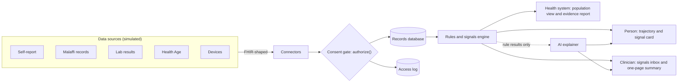

# Masar tech stack

What we are building is told in [story.md](story.md): Masar spots reproductive-health signals early (from records a person agrees to share), shows the person how things are changing over time, routes them to the right conversation, and proves to the health system that it happened earlier.

This document says what we build it with: for the **hackathon demo** first, and how each piece grows into a **real pilot** in Abu Dhabi.

## Principles

1. **One app for the demo.** A single Next.js codebase serves the person, the clinician and the health system. No separate backend services until a pilot needs them.
2. **Rules decide, AI explains.** Every judgement comes from readable, versioned rules. The AI only rewrites those results in plain language and organises them. It never produces a number, a diagnosis or a prediction.
3. **Standards-shaped from day one.** Data is shaped like FHIR R4 (the health-data exchange standard) so simulated connectors can later be swapped for real ones.
4. **Synthetic data only.** Nothing connects to Malaffi, Health Age or any real record during the hackathon.

## At a glance

| Layer | Hackathon demo | Pilot path | Status |
|---|---|---|---|
| App framework | Next.js 16 (App Router), React 19, TypeScript | Same | Have |
| Interface | Tailwind CSS v4 with Masar design tokens, Motion, Recharts and custom SVG charts | Same | Have |
| Languages | English and Arabic, full right-to-left layout | Add languages used by large resident groups (for example Urdu, Hindi, Tagalog) | Have |
| Person's front door | Installable web app (web manifest + service worker) with discreet in-app updates | Web push with neutral wording; embedded in existing patient apps | New |
| Clinician's front door | Signals inbox + one-page summary inside Masar | Launched from inside the clinic's record system (SMART on FHIR) | Partly have |
| Server logic | Next.js server actions and route handlers, Zod validation | Same; split into services only if scale demands it | Have |
| Database | Prisma 7 + SQLite (libSQL) | PostgreSQL hosted in the UAE, row-level security | Have |
| Health-data exchange | FHIR-shaped records, simulated connectors, FHIR export endpoint | Real feeds from Malaffi and labs | Partly have |
| Identity | Demo personas with a **signed** session cookie | UAE PASS for residents; facility single sign-on for clinicians | Fix needed |
| Consent and access | One `authorize()` gate, closed list of purposes (no employer or insurer), access log | Consent stored as FHIR Consent; tamper-evident log | Have |
| Rules and signals | Pure TypeScript rules with published thresholds and a version number | Same, plus clinical governance sign-off | Have, signals scan new |
| Background jobs | Signal scan as a script plus a "Run scan" demo button | Nightly scan on a Postgres-backed job queue (pg-boss) | New |
| AI explainer | Claude Opus 5.5 through the Anthropic TypeScript SDK | Same, with in-country routing confirmed | Have (replaced the Gemini hook) |
| Measurement | Short validated questionnaires, pathway timestamps, evidence and safety report | Reported to the Department of Health | New |
| Population view | Groups under 10 people hidden, funnel and equity charts | Optional differential privacy for small counts | Have |
| Testing | Vitest for rules, Playwright for the demo journey | Same, run on every change | New |
| Hosting | Vercel + Turso (hosted libSQL), plus an offline local copy | UAE cloud region | New |

## How the pieces connect

## What we already have

From the current repository, these carry straight over:

- **Rules engine** (`src/lib/engine/`): direction, confidence, drivers and gaps per health area; thresholds in `rules.ts`; trigger IDs that become signals.
- **Consent gate** (`src/lib/consent/authorize.ts`): one function every data read goes through, with blocked attempts logged.
- **Clinician one-pager and review** (accept, modify, override), which becomes the calibration data.
- **Population view** with the 10-person minimum group size and a false-reassurance monitor.
- **Simulated connectors**, the FHIR export route and about 600 synthetic residents.
- **Onboarding journey** and the redesigned interface.

## What we build

| # | Module | Where | What it does |
|---|---|---|---|
| 1 | Signal scan | `src/lib/engine/signals.ts`, `scripts/scan.ts`, new `Signal` table | Runs the rules over everyone who agreed, raises a signal with its reasons and evidence, routes it to the person and their clinician. One open signal per area and a cooldown, so nobody gets repeat alerts. |
| 2 | Trend and flag split | `src/lib/engine/reading.ts` (started) | Separates "how is this moving" (improving, steady, changing, not enough data) from "is this worth discussing, and why". Labels each comparison as normal variation or meaningful change. |
| 3 | Three-question patient view | Patient pages | What do we know? What's changing, and how sure are we? What should I do next, and when? |
| 4 | Consent per source in onboarding | Journey consent step | Separate on/off for each data source, as the brief requires. |
| 5 | Clinician signals inbox | Clinician workspace | Today's signals, oldest first, each opening the one-page summary. |
| 6 | Measurement checks | New `QuestionnaireResponse` table | A few Cardiff Fertility Knowledge Scale items (what people believe), the four-question SURE test (readiness to decide) and the six-item STAI-6 (anxiety), each before and after. |
| 7 | Evidence and safety report | Health-system workspace | Time from signal to counselling (usual care vs Masar, simulated), referrals completed, informed choice, anxiety change, reach by age, sex, nationality and language, how often clinicians agreed with each type of signal, and false reassurance. |
| 8 | Synthetic population | `prisma/seed.ts` extended | About 10,000 residents with an Abu Dhabi-like mix of age, sex, nationality and language. A fixed random seed so the demo is identical every time, plus a "usual care" timeline to compare against. |
| 9 | AI explainer | `src/server/ai/` | Plain-language explanations and clinician briefs (see below). |

## AI layer

**Model:** Claude Opus 5.5 (`claude-opus-5-5`) through the official TypeScript SDK, `@anthropic-ai/sdk`.

**Two jobs only:**

| Job | Who sees it | Settings |
|---|---|---|
| Explain a finding in plain English or Arabic | The person | Effort `low` for speed, short output |
| Draft a pre-visit brief: what changed, what's missing, why each item was flagged | The clinician | Effort `medium`, streamed |

**Guardrails:**

- **Input** is only the rules' structured result, the matching evidence-library entries and the chosen language. Raw records are never sent unless the person has switched on AI explanations (the existing `AiExplanation` consent purpose).
- **Output** uses structured outputs (`output_config.format`) with a JSON schema built from Zod, so every response has the same fields (for example `summary`, `cannotTell`, `questionsToAsk`).
- **Number check:** every number in the output must already appear in the input. Otherwise the response is discarded.
- **Banned wording:** the existing filter rejects "fertility score", "infertile" and similar.
- **Refusals and failures:** check `stop_reason` for `refusal`, enable the server-side refusal fallback (`fallbacks: "default"` with the `server-side-fallback-2026-07-01` beta), and on any failure show the rule-written text instead. The app never depends on the AI to work.
- **Logging:** each AI call is written to the access log with the model, time, and hashes of what went in and came out.
- **Prompt caching:** the fixed instructions and the evidence library come first and are cached. Check `usage.cache_read_input_tokens` to confirm the cache is being hit.
- **Current API rules:** no sampling parameters such as `temperature` (current models reject them) and no assistant prefill.
- **Evaluation:** a fixed set of synthetic persona cases checked for invented numbers, banned wording, reading level, and quality in Arabic and English.

**Status:** the team chose Claude, and it replaced the Gemini hook.

- **Done:** `src/server/ai/claude.ts` calls Claude Opus 5.5 for the person's explanation, with structured output, the refusal fallback and low effort. `src/lib/ai/guard.ts` holds the number, banned-wording and length checks, tested by `npm run check:ai`. Set `ANTHROPIC_API_KEY` to turn it on; without it Masar shows its own text.
- **Still to build:** the clinician pre-visit brief, logging each AI call to the access log, and the persona evaluation set. Prompt caching starts to matter with the brief, because its fixed instructions and evidence library are long enough to cache; today's short explanation prompt is not.

## Security and compliance

**Fix before the demo** (found in the code review):

- Sign the session cookie. Today it holds a plain user ID, so anyone who knows an ID can act as that person. Use `iron-session` or a signed token with `jose`.
- Require a session and demo mode for `resetDemo` and the demo actions.
- Send `runImport` and `moveAction` through `authorize()` so a clinician can only touch patients who consented.
- Rate-limit sign-in and demo endpoints.

**Pilot compliance targets** (to confirm with the Department of Health):

- Abu Dhabi Healthcare Information and Cyber Security Standard (ADHICS).
- UAE Federal Law No. 2 of 2019 on the use of ICT in health fields, which keeps health data inside the UAE.
- UAE Personal Data Protection Law (Federal Decree-Law No. 45 of 2021), where it applies.
- The Department of Health's policy on AI in healthcare.
- Confirm where AI inference runs and which provider route meets UAE data-residency rules before any real data is used.

## Hosting and demo day

- **Demo URL:** Vercel for the app and Turso for the database. Turso is hosted libSQL, so the existing `@libsql/client` adapter works unchanged.
- **Alternative:** one Docker container with the seeded SQLite file inside, on any host.
- **Always:** a local copy on the presenting laptop with seeded data and the "Reset demo" button, in case the venue network fails.
- **Pilot:** a UAE cloud region (for example Azure UAE North or Central, AWS me-central-1, or Core42), with managed PostgreSQL, a secrets vault, private networking and backups.

## Testing and quality

- **Vitest** for the rules: one golden case per persona, plus checks of invariants such as "not enough data is never shown as stable". The existing `npm run check:trajectory` assertions move here.
- **Playwright** for the six-step demo journey, in English and Arabic, on desktop and phone sizes. This is the test that protects the live demo.
- **Typecheck and lint** on every change (GitHub Actions).
- **Accessibility** to WCAG 2.2 AA, including right-to-left checks.

## What we drop or defer

- **A separate NestJS backend** (suggested in the earlier notes): not needed for the demo. Next.js handles the server side.
- **Native mobile apps:** the installable web app covers phones. Native only matters for real wearable syncing, which we simulate.
- **Living Well hubs and couple linking:** hidden from the demo path so the story stays focused. The code stays.
- **Real integrations:** simulated with FHIR-shaped data and clearly labelled.
- **`daisyui`:** listed as a dev dependency; remove it if nothing uses it.

## Decisions for the team

1. ~~**AI provider:**~~ decided: Claude.
2. **Demo hosting:** Vercel + Turso, or a single container.
3. **Extra languages** for the fair-reach story, and which ones.
